# BaghBaan AI

> **Your orchard's AI guardian.** Apple leaf disease detection for Kashmir apple farmers and agriculture field officers, in English, हिंदी and اردو.

<p>
  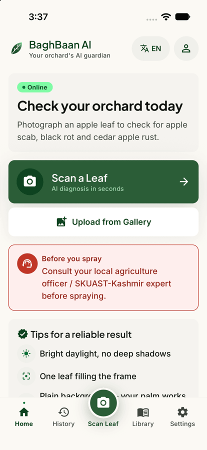
  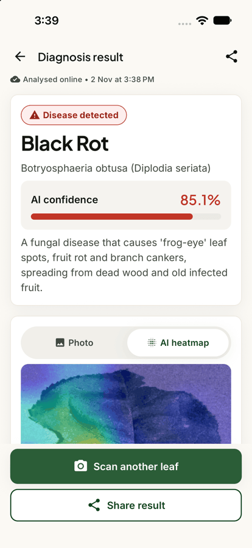
  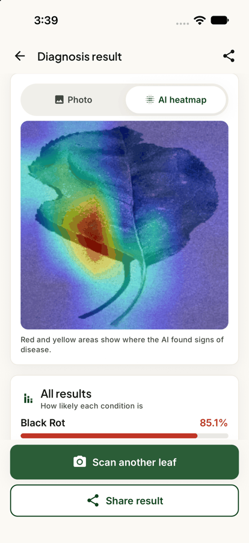
  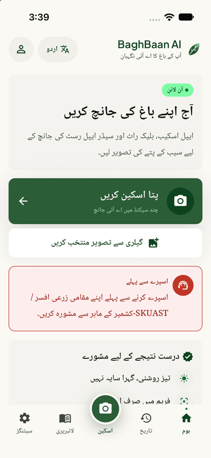
</p>

A farmer photographs one apple leaf. BaghBaan AI says whether it shows **apple scab, black rot or cedar apple rust**, or looks **healthy**; how confident it is; where on the leaf it saw signs of disease (Grad-CAM heatmap); and what the disease is and how to prevent it, in the farmer's language. It works **offline in the orchard** using an on-device model, and it **never prescribes pesticides or doses**: every result tells the user to consult their local agriculture officer or a SKUAST-Kashmir expert before spraying.

---

## Contents

[Problem](#problem) · [Solution](#solution) · [Architecture](#architecture) · [Tech stack](#tech-stack) · [Screenshots](#screenshots) · [Model results](#model-results) · [API](#api) · [Setup](#setup) · [Docker](#docker) · [Android APK](#android-apk) · [Deployment](#deployment) · [Limitations](#limitations) · [Business model](#business-model) · [Future scope](#future-scope)

## Problem

Apples are the backbone of Kashmir's horticulture economy, and fungal leaf diseases — above all **apple scab** in wet springs — can cost growers a season's crop. Diagnosis today depends on a field officer or SKUAST-Kashmir expert seeing the orchard, which is slow at the moment it matters most. Meanwhile farmers often spray on guesswork: wrong product, wrong timing, wasted money and chemical overuse.

Constraints that shape the product:

- Orchards often have **weak or no mobile signal**.
- Many users read **Urdu or Hindi** better than English, and use the phone outdoors in bright sun, sometimes in gloves.
- An app must **not pretend to be an agronomist**: a wrong spray recommendation is worse than none.

## Solution

| Need | What BaghBaan AI does |
|---|---|
| Fast first opinion | Photo → diagnosis in seconds, with a confidence score and all class probabilities |
| Trust and transparency | Grad-CAM heatmap shows *where* on the leaf the AI looked; below 70% confidence it says **"Not sure — retake photo or consult an expert"** instead of guessing |
| No signal in the orchard | A 2.7 MB quantised model runs on the phone; the online model adds the heatmap when there's a connection |
| Language and literacy | Full English / Hindi / Urdu (Urdu fully right-to-left), large text, 48 px+ tap targets, high contrast, haptics, screen-reader labels |
| Safety | Disease information and prevention only. No pesticide names or doses (enforced by a test); an always-visible note to consult an expert before spraying |
| Field record | Scan history on the phone; optional account (phone number + password) for a profile |

## Architecture

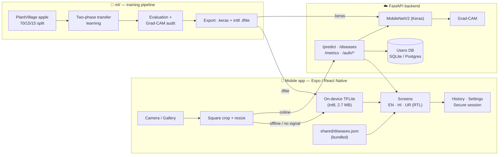

```
baghbaan-ai/
├── design/              Google Stitch export (visual reference only, not shipped)
├── ml/                  Data pipeline, training, evaluation, Grad-CAM, export (Python, TensorFlow)
├── backend/             FastAPI inference + accounts API, tests, Dockerfile
├── mobile/              Expo (React Native, TypeScript, Expo Router) app
├── shared/              diseases.json — disease content in 3 languages, used by backend and app
├── docs/                Screenshots, deployment guide
├── docker-compose.yml
└── .github/workflows/   CI (lint, type-check, tests, Docker build) and Android APK build
```

## Tech stack

| Area | Technology |
|---|---|
| ML | TensorFlow 2.21 / Keras 3, MobileNetV2 (ImageNet), scikit-learn, TFLite int8 quantisation |
| Backend | Python 3.12, FastAPI, Pydantic v2, SQLAlchemy 2, bcrypt + JWT, slowapi, Uvicorn, uv |
| Mobile | Expo SDK 58, React Native 0.88, TypeScript, Expo Router, Reanimated 4, i18next, react-native-fast-tflite, expo-camera, expo-secure-store |
| Design | Google Stitch export → design tokens (Plus Jakarta Sans, Inter, Noto Sans Devanagari, Noto Naskh Arabic) |
| DevOps | Docker, docker-compose, GitHub Actions, EAS Build, ruff, ESLint, pytest |

## Screenshots

| Home | Diagnosis | Heatmap | Probabilities + expert note |
|---|---|---|---|
|  |  |  | 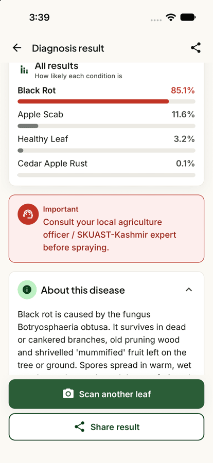 |

| History | Disease library | Disease detail | How it works (live metrics) | Urdu (RTL) |
|---|---|---|---|---|
| 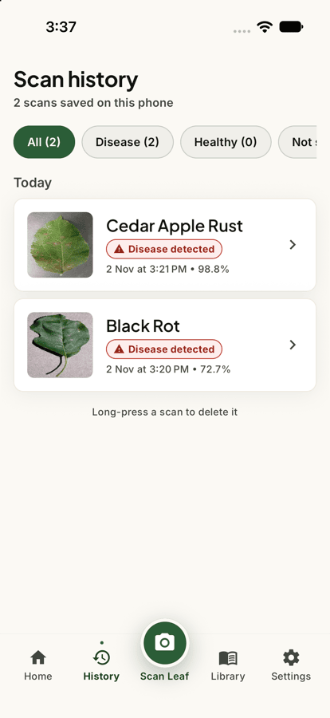 | 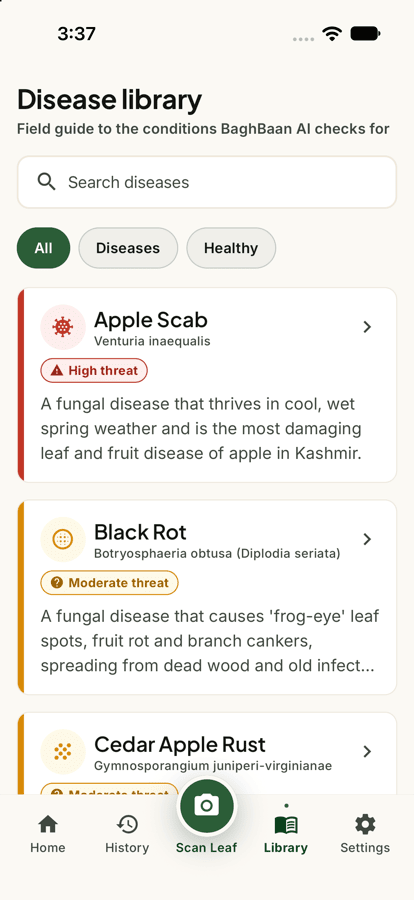 | 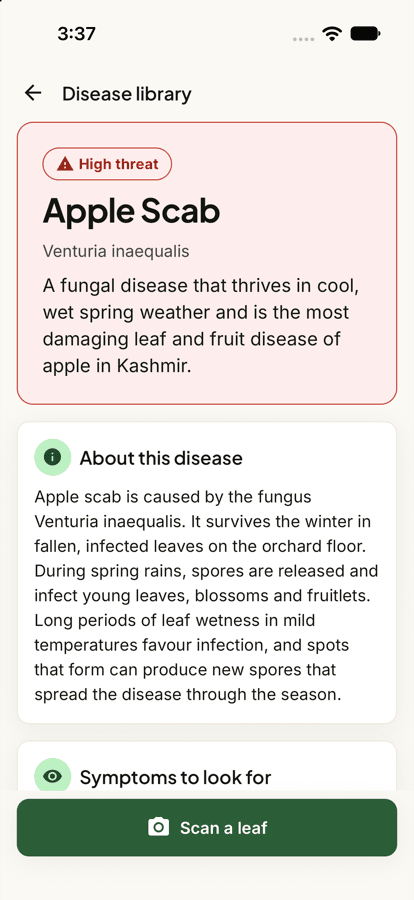 | 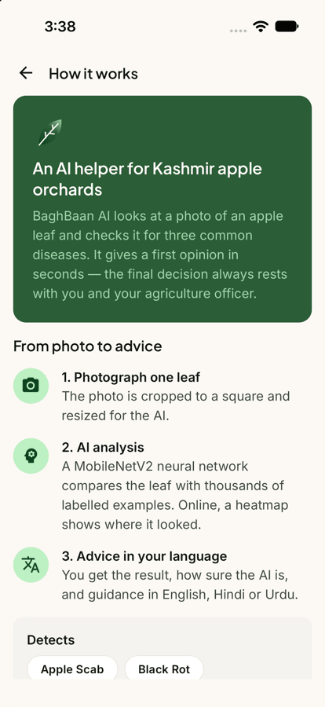 |  |

The original Stitch design is in [`design/`](design/); its tokens live in [`mobile/src/theme/tokens.ts`](mobile/src/theme/tokens.ts).

## Model results

Measured on **475 held-out test images** the model never saw during training (PlantVillage apple subset, 3,164 images after de-duplication, stratified 70/15/15 split, seed 42). Training took **9.4 minutes on a laptop CPU** (Apple Silicon).

| | Accuracy | Macro F1 | Size |
|---|---|---|---|
| Server model (Keras, MobileNetV2) | **98.3%** | 0.984 | 23 MB |
| On-device model (int8 TFLite) | **97.7%** | — | **2.7 MB** |

| Class | Precision | Recall | F1 | Test images |
|---|---|---|---|---|
| Apple Scab | 0.979 | 0.958 | 0.968 | 95 |
| Black Rot | 0.959 | 1.000 | 0.979 | 93 |
| Cedar Apple Rust | 1.000 | 1.000 | 1.000 | 41 |
| Healthy | 0.992 | 0.984 | 0.988 | 246 |

- **Confidence threshold (70%).** 96% of test photos get a diagnosis, and those are right **99.8%** of the time (one error). The other 4% get "Not sure" instead of a guess.
- **Grad-CAM audit.** 68–77% of the heatmap falls on the leaf, which covers only 40–49% of the photo, so the model mostly looks at the leaf, not the background.
- **Phone vs. server.** Re-running all 475 test photos through the app's exact preprocessing against the bundled model: the phone and server agree on 98.3% of predictions.

| Confusion matrix | Learning curves | Grad-CAM examples |
|---|---|---|
| 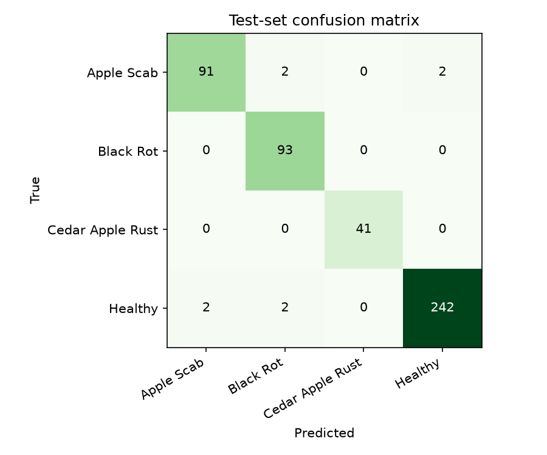 | 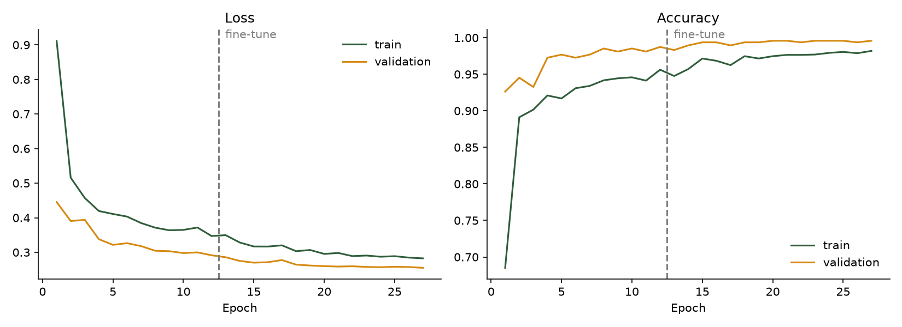 | 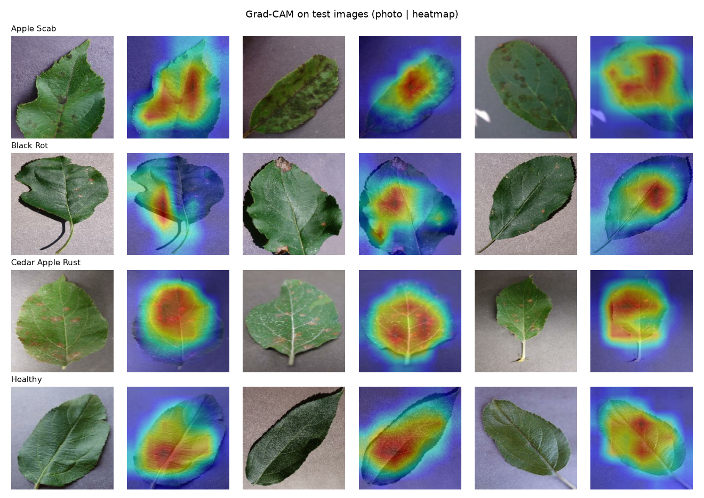 |

Full numbers: [`ml/reports/metrics.json`](ml/reports/metrics.json). Pipeline details: [`ml/README.md`](ml/README.md).

## API

Interactive docs at `/docs` (OpenAPI).

| Method & path | Purpose |
|---|---|
| `GET /health` | Liveness, whether the model loaded, model version |
| `GET /diseases` | All disease information in English, Hindi and Urdu |
| `GET /metrics` | Model performance report |
| `POST /predict?lang=en\|hi\|ur&heatmap=true` | Image → class, confidence, all probabilities, Grad-CAM PNG (base64), advice in the chosen language, low-confidence flag, expert note |
| `POST /auth/signup` | Create an account (name, Indian mobile number, password, role) → token |
| `POST /auth/login` | Phone + password → token |
| `GET /auth/me` | Current user (Bearer token) |

```bash
curl -F "file=@leaf.jpg;type=image/jpeg" "http://localhost:8000/predict?lang=ur"
```

Uploads are checked (JPEG/PNG/WebP, ≤ 8 MB, a real image); `/predict` and the sign-in endpoints are rate-limited per client; every request is logged as one JSON line. Scanning **never requires an account**.

## Setup

Requirements: [uv](https://docs.astral.sh/uv/), Node 22+, and for the native mobile build Xcode + CocoaPods (iOS) or an Android emulator / device.

```bash
git clone <this repo> baghbaan-ai && cd baghbaan-ai
```

**1. Train the model** (≈10 min on a laptop CPU; downloads ~51 MB of images):

```bash
cd ml && uv sync && uv run python -m baghbaan_ml.prepare_data && uv run python -m baghbaan_ml.train && uv run python -m baghbaan_ml.evaluate && uv run python -m baghbaan_ml.export
```

**2. Run the backend:**

```bash
cd backend && cp .env.example .env && cp ../ml/models/baghbaan_mobilenetv2.keras ../ml/models/metrics.json models/ && uv sync && uv run uvicorn app.main:app --host 0.0.0.0 --port 8000
```

**3. Run the app** (set `EXPO_PUBLIC_API_URL` in `mobile/.env` to your computer's network address, e.g. `http://192.168.1.10:8000`, when using a real phone):

```bash
cd mobile && cp .env.example .env && npm ci && npx expo run:ios
```

Use `npx expo run:android` for Android. A development build is needed (not Expo Go) because offline inference uses a native TFLite module. If you retrain, copy the new model into the app with `npm run sync-model`.

**Tests and checks** (the same commands CI runs):

```bash
cd backend && uv run ruff check . && uv run pytest -q
```

```bash
cd ml && uv run ruff check . && uv run pytest -q
```

```bash
cd mobile && npm run lint && npm run typecheck && npx expo-doctor
```

## Docker

```bash
cp backend/.env.example backend/.env && cp ml/models/baghbaan_mobilenetv2.keras ml/models/metrics.json backend/models/ && docker compose up --build
```

The API runs at <http://localhost:8000>. Model files are mounted read-only from `backend/models/`, and the accounts database is kept in a named volume.

## Android APK

Built in Expo's cloud with EAS. The `preview` profile produces an installable APK.

```bash
cd mobile && npx eas-cli@latest login && npx eas-cli@latest init
```

```bash
cd mobile && npx eas-cli@latest env:create --environment preview --name EXPO_PUBLIC_API_URL --value https://YOUR-API-URL
```

```bash
cd mobile && npx eas-cli@latest build --platform android --profile preview
```

Or add an `EXPO_TOKEN` repository secret and run the **Android APK** workflow from the GitHub Actions tab. Without `EXPO_PUBLIC_API_URL` the app still works, analysing everything on the phone.

## Deployment

Step-by-step guides for **Render**, **Railway** and **Hugging Face Spaces**, plus production settings: [`docs/DEPLOYMENT.md`](docs/DEPLOYMENT.md).

## Limitations

- **Lab photos, not orchards.** PlantVillage leaves are photographed one at a time on a plain background in even light. Real Kashmir orchard photos (clutter, shadows, glare, wet leaves, different cultivars) will score lower than 98%. The Grad-CAM audit shows some attention on shadows and backgrounds.
- **Four classes only.** The model knows apple scab, black rot, cedar apple rust and healthy. Powdery mildew, Alternaria leaf blotch, Marssonina blotch, mites, nutrient deficiency and other problems common in Kashmir are **not** detected — a leaf with them may be called "healthy" or misclassified.
- **Needs field validation and expert review.** Before real use, the model must be tested on labelled photos from Kashmir orchards, and the advice text reviewed by SKUAST-Kashmir / Department of Horticulture experts.
- **Translations** were written for this project and need review by native Hindi and Urdu speakers, ideally including Kashmiri agricultural terms.
- **Not an agronomist.** The app gives a first opinion and general guidance only; spray decisions must come from a qualified expert.
- Accounts have no password reset or SMS verification yet (both need an SMS provider).

## Business model

**Users (free):** apple farmers and orchard workers; agriculture extension and field officers.

**Paying customers:**

| Customer | What they buy |
|---|---|
| FPOs and apple grower cooperatives | Member-wide deployment, a dashboard of disease reports across members' orchards, early outbreak alerts |
| Agri-input companies | Region-level disease trend insights for planning stock and advisory campaigns (aggregated and anonymised; never product placement inside diagnoses) |
| Crop insurers | Time-stamped, photo-backed disease records to support claims assessment and risk models |
| Government / SKUAST extension programmes | Licensed tool for field officers, with training and custom content |

**Revenue streams:** institutional contracts (cooperatives, government programmes), annual subscriptions for organisations and officer teams, and data / research partnerships. Farmers keep scanning for free.

## Future scope

- Collect and label **Kashmir orchard photos** with SKUAST-Kashmir and retrain; add a "report wrong result" button to gather data.
- Add more diseases common in the valley (Alternaria, Marssonina, powdery mildew) and pests.
- Severity estimation and weather-based **spray-window alerts** (scab infection periods) from the Department of Horticulture's official schedule.
- **Kashmiri** language and voice read-out of results for low-literacy users.
- Officer dashboard: outbreak maps from opt-in scans, cooperative-level reports.
- Phone OTP sign-in, cloud sync of history across devices, and an iOS release.

## Acknowledgements

Training data: PlantVillage — Hughes & Salathé, *An open access repository of images on plant health to enable the development of mobile disease diagnostics* (arXiv:1511.08060). UI design created with Google Stitch.
